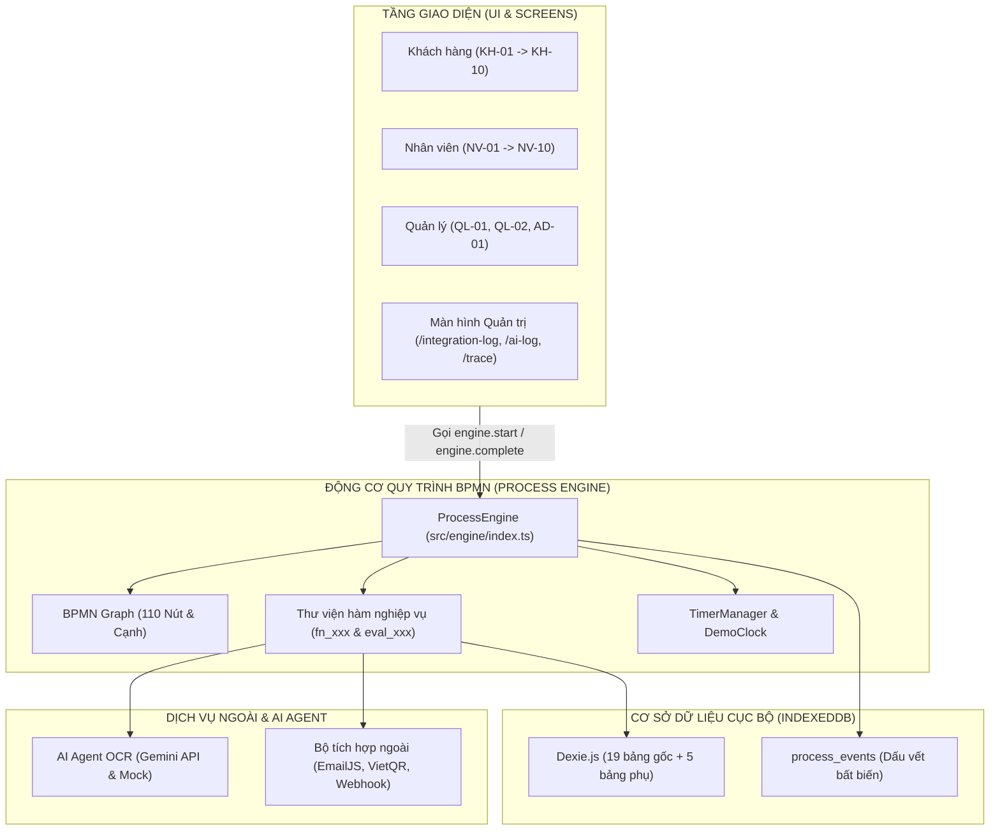

# TÀI LIỆU HƯỚNG DẪN GIẢI TRÌNH MÃ NGUỒN (CODE GUIDE)

> **Dự án:** MOTO CARE - Hệ Thống Cho Thuê Xe Máy Trực Tuyến  
> **Mục đích:** Cung cấp giải thích ngắn gọn, trực quan về kiến trúc và 10 đoạn mã cốt lõi nhất của dự án để tất cả thành viên trong nhóm tự tin vấn đáp và giải trình trước hội đồng thẩm định.  

---

## 1. Sơ Đồ Kiến Trúc Hệ Thống (Frontend-Only Architecture)

---

## 2. Luồng Vận Hành Của Một Yêu Cầu Thuê Xe Qua Động Cơ BPMN

1. **Khởi tạo (`M_START`):** Người dùng bấm nộp đơn tại `KH-01`. Component gọi `engine.start(actor, data)`. Động cơ tạo bản ghi `rental_requests`, khởi tạo `process_state`, ghi sự kiện `START_PROCESS` và gọi Webhook No-Code.
2. **Tự động tiến bước (`engine.advance`):** Động cơ thực thi các nút tự động (`Service Task`, `Business Rule Task`, `XOR Gateway`):
   - `M_CheckFleet`: Tìm xe phù hợp.
   - `M_G01`: Cổng XOR rẽ nhánh có xe (`M_SendTerms`) hoặc hết xe (`M_RejectNoVehicle`).
   - `M_SendTerms`: Gửi báo giá qua Notifier.
   - `M_CheckDocs`: Gọi AI Agent OCR trích xuất CCCD/GPLX, tính điểm $m$, so sánh ngưỡng $X=0.95$ và $Y=0.80$.
3. **Dừng tại điểm chờ (`enterWaitPoint`):** Khi gặp `User Task` hoặc `Receive Task` (ví dụ `M_WaitDeposit`, `M_WaitSign`), engine lưu danh sách nút chờ vào `process_state.waiting_node_ids` và thiết lập đồng hồ đếm ngược (`timerManager`).
4. **Tương tác hoàn thành (`engine.complete`):** Người dùng hoặc nhân viên hoàn tất tác vụ trên giao diện (ví dụ chuyển khoản cọc), gọi `engine.complete(requestId, nodeId, payload)`. Động cơ gỡ điểm chờ, ghi nhận kết quả và lặp lại chu trình `advance` cho đến nút kết thúc `M_END`.

---

## 3. Danh Sách 10 Đoạn Mã Cốt Lõi Quan Trọng Nhất

### 1. Hàm điều hướng tự động: `engine.advance()`
- **Vị trí file:** [`src/engine/index.ts`](file:///c:/Users/USER/Downloads/WEB%20MOTO%20CARE/WEB%20MOTO%20CARE/src/engine/index.ts) (dòng 180 - 260)
- **Giải thích:** Vòng lặp `while(true)` cốt lõi của động cơ quy trình. Hàm tự động duyệt từ nút hiện tại sang các nút kế tiếp dựa trên đồ thị BPMN. Vòng lặp chỉ dừng lại khi: (a) gặp **Điểm chờ (Wait Point)** tương tác của con người, (b) gặp **Sự kiện kết thúc (End Event)**, hoặc (c) kích hoạt **Tiểu quy trình (Sub-Process)**.

### 2. Định nghĩa và thẩm định cạnh đồ thị BPMN: `bpmnGraph.assertEdge()`
- **Vị trí file:** [`src/engine/graph.ts`](file:///c:/Users/USER/Downloads/WEB%20MOTO%20CARE/WEB%20MOTO%20CARE/src/engine/graph.ts)
- **Giải thích:** Đóng băng toàn bộ cấu trúc 110 phần tử của file `MotoCare_TO_BE.bpmn`. Bất kỳ khi nào engine chuyển bước, hàm `assertEdge(from, to)` sẽ kiểm tra xem cạnh nối có tồn tại trong BPMN To-Be không. Nếu code nhảy cóc sai quy trình, hệ thống sẽ ném ngoại lệ chặn đứng vi phạm ngay lập tức.

### 3. Bộ quét timer và kích hoạt sự kiện biên: `sweepTimers()`
- **Vị trí file:** [`src/engine/timers.ts`](file:///c:/Users/USER/Downloads/WEB%20MOTO%20CARE/WEB%20MOTO%20CARE/src/engine/timers.ts)
- **Giải thích:** Định kỳ mỗi 1 giây (hoặc khi người dùng bấm tua thời gian trong `DevPanel`), hàm quét bảng `timers` trong IndexedDB. So sánh thời điểm hết hạn `due_at` với giờ hiện tại của đồng hồ mô phỏng `clock.now()`. Nếu quá hạn, tự động kích hoạt callback để ngắt luồng (Boundary Timer Event) như hết hạn cọc 30 phút (`M_BoundDeposit`) hoặc quá hạn ký 24h (`M_BoundSign`).

### 4. Thuật toán phân nhánh AI Agent OCR theo ngưỡng X/Y: `fn_check_documents()`
- **Vị trí file:** [`src/engine/fn/index.ts`](file:///c:/Users/USER/Downloads/WEB%20MOTO%20CARE/WEB%20MOTO%20CARE/src/engine/fn/index.ts) (dòng 195 - 260)
- **Giải thích:** Gọi AI Agent OCR trích xuất thông tin ảnh CCCD/GPLX, lấy điểm phân nhánh $m = \min(\text{confidence})$. So sánh với $X = 0.95$ và $Y = 0.80$:
  - $m \ge X$: `PREFILL_FOR_RULES` (tự động sang cổng `M_G02`).
  - $Y \le m < X$ hoặc lệch tên: `MANUAL_REVIEW` (chờ người xác minh).
  - $m < Y$ hoặc ảnh mờ: `REQUEST_REUPLOAD` (yêu cầu nộp lại ảnh).

### 5. Cơ chế gọi API ngoài bền bỉ: `safeExecuteWithRetry()`
- **Vị trí file:** [`src/integrations/client.ts`](file:///c:/Users/USER/Downloads/WEB%20MOTO%20CARE/WEB%20MOTO%20CARE/src/integrations/client.ts)
- **Giải thích:** Vòng lặp an toàn bọc ngoài mọi lệnh gọi Notifier, VietQR và Webhook. Thiết lập timeout 5 giây bằng `AbortController`, tự động thử lại tối đa 2 lần với thuật toán backoff, đo lường độ trễ và ghi nhật ký vào `db.integration_logs`. Nếu thất bại toàn bộ, trả về `success: false` an toàn để bảo vệ động cơ BPMN không bị crash (Graceful Degradation).

### 6. Tạo mã QR thanh toán chuẩn quốc gia: `generateQr()`
- **Vị trí file:** [`src/integrations/qr/index.ts`](file:///c:/Users/USER/Downloads/WEB%20MOTO%20CARE/WEB%20MOTO%20CARE/src/integrations/qr/index.ts)
- **Giải thích:** Sinh đường dẫn ảnh VietQR QuickLink theo chuẩn Napas 24/7 (`https://img.vietqr.io/image/...`) cho phép quét bằng ứng dụng mọi ngân hàng Việt Nam. Đồng thời tạo chuỗi text EMVCo tiêu chuẩn và hỗ trợ fallback sang render Canvas bằng thư viện `qrcode` khi chạy offline.

### 7. Tính phí bảng kê và đối trừ tiền cọc: `fn_net_deposit()`
- **Vị trí file:** [`src/engine/fn/index.ts`](file:///c:/Users/USER/Downloads/WEB%20MOTO%20CARE/WEB%20MOTO%20CARE/src/engine/fn/index.ts) (dòng 820 - 860)
- **Giải thích:** Tính toán số dư thanh lý: $\text{balance} = \text{tiền cọc thực nhận} - \text{tổng chi phí bảng kê}$.
  - $\text{balance} > 0$: Hoàn dư tiền cọc thừa cho khách (`M_Refund`).
  - $\text{balance} = 0$: Cân bằng đối trừ trọn vẹn, thanh lý trực tiếp (`M_Settle`).
  - $\text{balance} < 0$: Thu thêm phụ phí hư hỏng/trễ hạn qua VietQR (`M_PayExtra`).

### 8. Băm mật khẩu một chiều Web Crypto API: `hashPassword()`
- **Vị trí file:** [`src/features/auth/authStore.ts`](file:///c:/Users/USER/Downloads/WEB%20MOTO%20CARE/WEB%20MOTO%20CARE/src/features/auth/authStore.ts)
- **Giải thích:** Sử dụng chuẩn mã hóa tiêu chuẩn công nghiệp: Sinh Salt ngẫu nhiên 16 bytes bằng `crypto.getRandomValues()`, sau đó dẫn xuất khóa băm qua thuật toán `PBKDF2` với hàm băm `SHA-256` và 100.000 vòng lặp. Lưu trữ chuỗi băm hex và salt, không lưu mật khẩu thô.

### 9. Ràng buộc bảo vệ quyền Actor theo vai trò: `checkActorRole()`
- **Vị trí file:** [`src/engine/index.ts`](file:///c:/Users/USER/Downloads/WEB%20MOTO%20CARE/WEB%20MOTO%20CARE/src/engine/index.ts) (dòng 80 - 116)
- **Giải thích:** Bảng ma trận `TASK_ROLE_MAP` quy định chính xác vai trò nào được phép thao tác tại từng nút nghiệp vụ. Ví dụ `M_Resolve` chỉ dành cho `quan_ly`, `M_InspectPre` dành cho `nhan_vien`. Bất kỳ yêu cầu nào vi phạm vai trò đều bị từ chối ngay từ tầng engine.

### 10. Chốt hợp đồng và đóng băng lưu hồ sơ: `fn_archive()`
- **Vị trí file:** [`src/engine/fn/index.ts`](file:///c:/Users/USER/Downloads/WEB%20MOTO%20CARE/WEB%20MOTO%20CARE/src/engine/fn/index.ts) (dòng 1000 - 1040)
- **Giải thích:** Hoạt động cuối cùng `M_Archive` của chu trình To-Be: Thiết lập mốc thời gian `archived_at`, `closed_at`, chuyển trạng thái hợp đồng và yêu cầu sang `HOAN_TAT`. Đóng băng toàn bộ dữ liệu để chuyển sang chế độ chỉ đọc (Read-only) và đưa vào danh sách lịch sử tra cứu của khách hàng.

