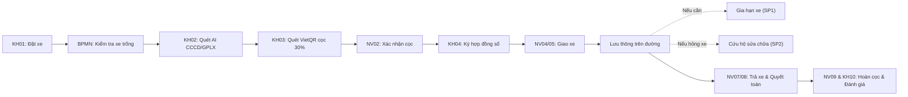

# CẤU TRÚC CÂY THƯ MỤC & GIẢI THÍCH MÃ NGUỒN DỰ ÁN MOTO CARE

> **Tài liệu tham chiếu cấu trúc toàn bộ dự án:** Hệ thống Quản lý và Cho thuê Xe máy Trực tuyến vận hành theo mô hình Quy trình nghiệp vụ BPMN 2.0 (To-Be).

---

## 🌳 PHẦN 1: SƠ ĐỒ CÂY THƯ MỤC TỔNG THỂ

```text
web-moto-care/
├── .github/
│   └── workflows/
│       └── deploy.yml              # CI/CD tự động build & deploy lên GitHub Pages
├── docs/                           # Tài liệu thiết kế hệ thống, BPMN và ma trận truy vết
│   ├── AI_LOG.md                   # Nhật ký thiết kế AI Agent OCR
│   ├── Antigravity_Prompts_MotoCare.md # Kịch bản prompt phát triển dự án
│   ├── ASSUMPTIONS.md              # Các giả định nghiệp vụ hệ thống
│   ├── CODE_GUIDE.md               # Chuẩn lập trình và quy ước mã nguồn
│   ├── data-model.csv              # Đặc tả mô hình dữ liệu (Database Schema)
│   ├── DEMO_SCRIPT.md              # Kịch bản demo chạy quy trình từ A đến Z
│   ├── DOD_CHECKLIST.md            # Tiêu chí hoàn thành tính năng (Definition of Done)
│   ├── mapping.csv                 # Ánh xạ mã màn hình UI với các Node BPMN
│   ├── message-flows.csv           # Đặc tả luồng thông điệp giữa các bên
│   ├── MotoCare_TO_BE.bpmn         # File sơ đồ quy trình nghiệp vụ chuẩn BPMN 2.0
│   ├── process-graph.json          # Đồ thị chuyển đổi trạng thái của BPMN Engine
│   ├── PROJECT_STRUCTURE.md        # File tài liệu này (Cấu trúc cây tệp & giải thích)
│   ├── QUESTIONS.md                # Ghi nhận câu hỏi và giải pháp kiến trúc
│   ├── screens.csv                 # Danh mục 23 màn hình chức năng của hệ thống
│   ├── SECURITY_CHECKLIST.md       # Bảng kiểm tra an toàn thông tin & Web Crypto
│   └── TRACEABILITY.md             # Ma trận truy vết từ yêu cầu đến code & test
├── public/                         # Tài nguyên tĩnh phục vụ trực tiếp cho trình duyệt
│   ├── 404.html                    # Chống lỗi 404 khi F5 trang trên GitHub Pages (SPA Router)
│   ├── favicon.svg                 # Biểu tượng website (Logo MOTO CARE)
│   ├── manifest.json               # Cấu hình PWA (Progressive Web App)
│   ├── sw.js                       # Service Worker hỗ trợ lưu cache offline
│   └── images/                     # Ảnh tĩnh (Banner xe, hình ảnh các dòng xe máy)
├── supabase/
│   └── schema.sql                  # Script tạo bảng và chính sách bảo mật RLS trên PostgreSQL Supabase
├── tests/                          # Bộ kiểm thử tự động toàn diện
│   ├── e2e/                        # Kiểm thử đầu-cuối giao diện người dùng (Playwright)
│   │   ├── document_ocr.spec.ts    # Test luồng chụp & đọc giấy tờ
│   │   ├── phase4_flow.spec.ts     # Test luồng Đặt xe -> Bàn giao
│   │   ├── phase5_flow.spec.ts     # Test luồng Gia hạn & Sự cố khi đang thuê
│   │   ├── phase6_flow.spec.ts     # Test luồng Trả xe -> Quyết toán
│   │   ├── phase7_integrations.spec.ts # Test thanh toán VietQR & thông báo
│   │   └── phase8_ai.spec.ts       # Test giao diện AI OCR trích xuất thông tin
│   └── unit/                       # Kiểm thử đơn vị & máy trạng thái lõi (Vitest)
│       ├── auth_router.test.tsx    # Test phân quyền và mã hóa mật khẩu PBKDF2
│       ├── database.test.ts        # Test cơ sở dữ liệu IndexedDB Dexie
│       ├── engine.test.ts          # Test chuyển bước quy trình chính (Main Process)
│       ├── engine_sp.test.ts       # Test quy trình con Gia hạn (SP1) & Sự cố (SP2)
│       ├── kh02_ocr.test.tsx       # Test vòng đời màn hình quét giấy tờ KH02
│       ├── ocr_pipeline.test.ts    # Test đường ống xử lý OCR và single-flight job
│       ├── ocr_robustness.test.ts  # Test độ bền bỉ khi đọc chuỗi/ký tự mờ nhòe
│       ├── setup.ts                # Cấu hình môi trường mock IndexedDB/Canvas cho Vitest
│       └── vehicle_double_booking.test.ts # Test chống trùng lịch đặt xe
├── src/                            # TOÀN BỘ MÃ NGUỒN CHÍNH CỦA ỨNG DỤNG
│   ├── App.tsx                     # Component gốc điều phối Layout và Route
│   ├── main.tsx                    # Điểm vào ứng dụng (Entry point) khởi tạo React DOM
│   ├── index.css                   # Định kiểu toàn cục, cấu hình font Be Vietnam Pro & Tailwind
│   ├── copy.ts                     # Từ điển ngôn ngữ, câu chữ thông báo trong ứng dụng
│   ├── vite-env.d.ts               # Khai báo kiểu dữ liệu biến môi trường Vite (import.meta.env)
│   ├── ai/                         # Phân hệ AI Agent OCR đọc CCCD/GPLX
│   │   ├── errors.ts               # Lớp định nghĩa mã lỗi OCR chuẩn hóa (OcrError)
│   │   ├── gemini.ts               # Trình kết nối Google Gemini API (2.5/3.x Flash)
│   │   ├── images.ts               # Nén ảnh, scale 1400px, validate định dạng & dung lượng
│   │   ├── index.ts                # Facade trung tâm điều phối Gemini / Local / Mock OCR
│   │   ├── local.ts                # Bộ OCR chạy trực tiếp trên máy client bằng Tesseract.js
│   │   ├── mock.ts                 # Bộ giả lập AI phục vụ chạy demo / offline siêu tốc
│   │   ├── ocr.worker.ts           # Web Worker chạy Tesseract đa luồng không đơ giao diện
│   │   ├── ocrLanguages.ts         # Quản lý đường dẫn tải dữ liệu ngôn ngữ tiếng Việt (vie/eng)
│   │   ├── ocrPreprocess.ts        # Tiền xử lý ảnh: khử nhiễu, tăng tương phản, nhị phân hóa
│   │   ├── realOcr.ts              # Thuật toán bóc tách regex họ tên, số CCCD, ngày sinh, hạng bằng
│   │   ├── timeout.ts              # Quản lý thời gian deadline cho tác vụ OCR (AbortController)
│   │   ├── types.ts                # Định nghĩa interface dữ liệu đầu vào/ra của AI
│   │   └── validation.ts           # Kiểm tra tính hợp lệ dữ liệu OCR bằng Zod Schema
│   ├── app/                        # Điều hướng và bọc ngữ cảnh (Providers & Router)
│   │   ├── ProtectedRoute.tsx      # Bộ gác cổng kiểm tra đăng nhập & phân quyền vai trò (RBAC)
│   │   ├── providers.tsx           # Bọc các Context: Router, Toast, Quản lý phiên
│   │   └── router.tsx              # Cấu hình danh mục tất cả đường dẫn URL (Routes)
│   ├── components/                 # Các thành phần giao diện tái sử dụng
│   │   ├── DevPanel.tsx            # Bảng điều khiển dành cho lập trình viên (Chuyển vai trò, chỉnh thời gian)
│   │   ├── common/                 # Component dùng chung (Logo, BpmnBadge, Thanh thông báo)
│   │   ├── layout/                 # Khung sườn màn hình cho Khách hàng, Nhân viên, Quản lý
│   │   ├── timeline/               # Biểu đồ Gantt trực quan hóa lịch trình xe (FleetTimeline)
│   │   └── ui/                     # Bộ UI chuẩn Design System (Button, Modal, Input, QRBox, Table...)
│   ├── config/                     # Cấu hình tập trung của dự án
│   │   ├── ai.ts                   # Cấu hình ngưỡng tin cậy X/Y, API key, model Gemini
│   │   ├── integrations.ts         # Cấu hình VietQR, EmailJS, Webhook
│   │   └── rules.ts                # Bảng quy tắc nghiệp vụ: mức cọc, bảng giá, phụ phí đền bù
│   ├── db/                         # Cơ sở dữ liệu nội bộ (IndexedDB Client-side)
│   │   ├── adapter.ts              # Cầu nối đồng bộ dữ liệu giữa Dexie và Supabase
│   │   ├── backup.ts               # Xuất/Nhập dữ liệu dự án ra file JSON (Sao lưu & Phục hồi)
│   │   ├── index.ts                # Khởi tạo instance kết nối cơ sở dữ liệu Dexie
│   │   ├── schema.ts               # Định nghĩa các Table và Index trong IndexedDB
│   │   ├── seed.ts                 # Dữ liệu mẫu ban đầu (Danh sách xe, tài khoản demo)
│   │   ├── types.ts                # TypeScript Types cho từng bảng dữ liệu
│   │   └── repo/index.ts           # Tầng Repository thao tác CRUD với database
│   ├── engine/                     # TRÁI TIM HỆ THỐNG: MÁY TRẠNG THÁI BPMN PROCESS ENGINE
│   │   ├── bpmEngine.ts            # Bộ thực thi chuyển dịch node theo sự kiện BPMN
│   │   ├── fleet.ts                # Thuật toán kiểm tra xe trống và chống xung đột lịch thuê
│   │   ├── graph.ts                # Định nghĩa đồ thị quy trình nghiệp vụ To-Be
│   │   ├── index.ts                # Điểm xuất khẩu các hàm điều khiển tiến trình BPMN
│   │   ├── timers.ts               # Bộ đếm giờ tự động (Hết hạn cọc 30p, hết hạn ký 24h)
│   │   └── fn/                     # Các hàm thực thi nghiệp vụ tương ứng từng Node BPMN
│   │       ├── index.ts            # Nghiệp vụ quy trình chính (M_START -> M_END)
│   │       └── sp.ts               # Nghiệp vụ quy trình con: Gia hạn (SP1) & Sự cố (SP2)
│   ├── features/                   # CÁC MÀN HÌNH CHỨC NĂNG THEO TỪNG VAI TRÒ
│   │   ├── admin/                  # Phân hệ Quản trị viên (AD01 - Phân quyền tài khoản)
│   │   ├── auth/                   # Màn hình đăng nhập, mã hóa Web Crypto (PBKDF2)
│   │   ├── bpmn/                   # Kho lưu trữ trạng thái hiển thị node quy trình BPMN
│   │   ├── customer/               # Phân hệ Khách hàng (KH01 -> KH10, LandingPage)
│   │   ├── manager/                # Phân hệ Quản lý (QL01, QL02, Biểu đồ, Nhật ký AI, Vết luồng)
│   │   ├── partner/                # Phân hệ Đối tác cứu hộ (DT01 - Tiếp nhận sự cố xe)
│   │   └── staff/                  # Phân hệ Nhân viên (NV01 -> NV10 - Giao/nhận xe, kiểm kê)
│   ├── integrations/               # Cổng kết nối dịch vụ bên thứ ba
│   │   ├── client.ts               # Client thống nhất gọi tích hợp ngoài
│   │   ├── notifier/               # Gửi email thật qua EmailJS REST API
│   │   ├── qr/                     # Sinh mã thanh toán chuẩn VietQR / Napas247
│   │   └── webhook/                # Bắn webhook sự kiện BPMN sang n8n / Zapier / Make
│   ├── lib/                        # Thư viện tiện ích
│   │   ├── clock.ts                # Đồng hồ mô phỏng (Tua nhanh thời gian để kiểm thử)
│   │   ├── format.ts               # Định dạng tiền tệ VND, ngày tháng tiếng Việt
│   │   ├── supabase.ts             # Client kết nối Supabase Cloud PostgreSQL
│   │   └── utils.ts                # Các hàm tiện ích gộp chuỗi class (clsx, tailwind-merge)
│   └── theme/
│       └── tokens.ts               # Bảng màu sắc, kích thước chuẩn thương hiệu MotoCare
├── .env                            # Biến môi trường thực tế đang chạy trên máy
├── .env.example                    # File mẫu hướng dẫn khai báo biến môi trường
├── .gitignore                      # Danh sách file/thư mục không đưa lên Git (node_modules, .env...)
├── AI_DOCUMENT_PROCESSING_PLAN.md  # Bản đặc tả kỹ thuật chi tiết phân hệ AI OCR
├── eslint.config.js                # Cấu hình kiểm tra chuẩn cú pháp mã nguồn ESLint
├── index.html                      # File HTML gốc chứa thẻ <div id="root">
├── netlify.toml                    # Cấu hình điều hướng triển khai trên Netlify
├── package.json                    # Khai báo các thư viện phụ thuộc và lệnh chạy (scripts)
├── package-lock.json               # Khóa chính xác phiên bản của từng thư viện
├── playwright.config.ts            # Cấu hình chạy test E2E đa trình duyệt (Chrome, Safari, Firefox)
├── postcss.config.js               # Plugin chuyển đổi CSS cho Tailwind
├── README.md                       # Bản giới thiệu tổng quan, kiến trúc và hướng dẫn cài đặt
├── tailwind.config.js              # Cấu hình màu sắc, breakpoint, font chữ Tailwind CSS
├── tsconfig.json                   # Cấu hình trình biên dịch TypeScript & alias `@/`
├── vercel.json                     # Cấu hình điều hướng triển khai trên Vercel
└── vite.config.ts                  # Cấu hình bộ đóng gói Vite, subpath GitHub Pages và Vitest
```

---

## 🔍 PHẦN 2: GIẢI THÍCH CHI TIẾT TỪNG PHÂN HỆ VÀ TỪNG FILE

### 1. Thư mục cấu hình gốc (Root Configs)
- **`.env` & `.env.example`**: Chứa các biến cấu hình: URL/Key Supabase, tài khoản ngân hàng VietQR, cấu hình AI Mode (`LIVE`, `LOCAL`, `MOCK`), API Key Gemini.
- **`package.json`**: Khai báo các dependency trọng yếu: `react`, `react-router-dom`, `dexie` (IndexedDB), `@supabase/supabase-js`, `tesseract.js`, `lucide-react`, `zod`, `vitest`, `playwright`.
- **`vite.config.ts`**: Bộ não đóng gói mã nguồn:
  - Tự động gán đường dẫn `base` phù hợp: nhận diện chạy trên GitHub Pages (`/web-moto-care/`), Vercel (`/`), hay local (`./`).
  - Cấu hình phân tách file (manual chunks) thành `react-vendor`, `db-vendor`, `ui-vendor` để tối ưu tải trang cực nhanh.
  - Thiết lập môi trường test `vitest` với `jsdom`.
- **`tsconfig.json`**: Khai báo alias `@/*` ánh xạ trực tiếp vào `./src/*`, giúp việc import code ngắn gọn và nhất quán.

---

### 2. Thư mục `public/` (Web Assets & SPA Support)
- **`public/404.html`**: Chứa kịch bản JavaScript chuyển hướng SPA. Khi triển khai trên GitHub Pages, nếu người dùng F5 tại các đường dẫn con, GitHub Pages sẽ gọi file này để điều hướng mượt mà về `index.html` kèm hash route, **chống hoàn toàn lỗi 404**.
- **`public/manifest.json` & `public/sw.js`**: Giúp hệ thống hoạt động như một ứng dụng web lũy tiến (PWA), có thể cài đặt về màn hình chính điện thoại và chạy offline.

---

### 3. Phân hệ `src/ai/` (AI Agent OCR Thông Minh)
Đây là phân hệ thực hiện hoạt động **M_CheckDocs** trong mô hình BPMN, giúp bóc tách thông tin từ ảnh chụp giấy tờ:
- **`src/ai/gemini.ts`**: Gọi trực tiếp tới Google Gemini API với JSON Schema chặt chẽ. Đã được thiết lập `thinkingBudget: 0` giúp trích xuất siêu tốc trong **3 giây**.
- **`src/ai/images.ts`**: Tự động nén ảnh giấy tờ về độ phân giải chuẩn 1400px (giữ nguyên độ nét của số và chữ có dấu nhưng giảm 70% dung lượng) chống nghẽn mạng.
- **`src/ai/local.ts` & `src/ai/ocr.worker.ts`**: Bộ OCR chạy độc lập trên trình duyệt bằng WebAssembly và Web Worker, giúp nhận diện offline mà không làm đơ giao diện người dùng.
- **`src/ai/realOcr.ts`**: Bộ quy tắc bóc tách regex tiếng Việt: tìm nhãn họ tên, số CCCD 12 chữ số, ngày sinh, hạng bằng lái (A1, A2, B1...) và đối chiếu độ trùng khớp tên giữa CCCD và GPLX.
- **`src/ai/mock.ts`**: Giả lập AI trả về ngay kết quả chuẩn xác trong 0.2 giây phục vụ kiểm thử và demo không cần mạng.

---

### 4. Phân hệ `src/engine/` (Trái Tim: Máy Trạng Thái Quy Trình BPMN)
Toàn bộ logic vận hành của MOTO CARE được điều khiển bởi máy trạng thái BPMN (Process Engine), không phải code rời rạc:
- **`src/engine/bpmEngine.ts`**: Lõi thực thi quy trình: nhận sự kiện (`trigger()`), kiểm tra điều kiện chuyển nhánh (Gateways), ghi nhận lịch sử di chuyển (Audit Trail) và chuyển tiếp giữa các Node.
- **`src/engine/graph.ts`**: Khai báo toàn bộ cấu trúc đồ thị BPMN To-Be:
  - **Quy trình chính**: `M_START` ➔ `M_CheckFleet` ➔ `M_SendTerms` ➔ `M_CheckDocs` ➔ `M_CreateDeposit` ➔ `M_WaitDeposit` ➔ `M_CheckDeposit` ➔ `M_Contract` ➔ `M_WaitSign` ➔ `M_PreInspect` ➔ `M_Handover` ➔ `M_Rent` ➔ `M_ReturnInspect` ➔ `M_Settle` ➔ `M_ReceiveReview` ➔ `M_ConfirmRefund` ➔ `M_END`.
- **`src/engine/fleet.ts`**: Thuật toán thông minh tự động tìm xe còn trống và chống trùng lịch thuê (overlap booking) theo từng mốc thời gian nhận - trả.
- **`src/engine/timers.ts`**: Quản lý các bộ đếm thời gian tự động:
  - Hết 30 phút chưa đặt cọc ➔ Hủy yêu cầu (`QUA_HAN_COC`).
  - Hết 24 giờ chưa ký hợp đồng điện tử ➔ Tự động hoàn cọc và hủy đơn (`QUA_HAN_KY`).
- **`src/engine/fn/sp.ts`**: Xử lý 2 quy trình con (Sub-processes):
  - **SP1 (Gia hạn thuê xe)**: Khách yêu cầu gia hạn ➔ Kiểm tra trùng lịch xe ➔ Báo phí phát sinh ➔ Thu phí bổ sung ➔ Cập nhật hợp đồng.
  - **SP2 (Sự cố trên đường)**: Khách báo hỏng xe/tai nạn ➔ Điều phối đối tác cứu hộ gần nhất ➔ Khắc phục tại chỗ hoặc đổi xe tương đương cho khách.

---

### 5. Phân hệ `src/db/` (Tầng Lưu Trữ Cơ Sở Dữ Liệu)
- **`src/db/index.ts` & `src/db/schema.ts`**: Định nghĩa các bảng dữ liệu bằng Dexie.js (IndexedDB trong trình duyệt):
  - `vehicles` (Kho xe máy), `rental_requests` (Yêu cầu thuê xe), `process_state` (Trạng thái Node BPMN), `contracts` (Hợp đồng), `payments` (Lịch sử thanh toán cọc), `customer_documents` (Ảnh CCCD/GPLX & kết quả AI OCR), `ai_logs` (Nhật ký phân tích AI).
- **`src/db/seed.ts`**: Nạp dữ liệu mẫu ban đầu: 12 dòng xe máy (Honda Air Blade, Vision, Wave Alpha, Winner X, Yamaha Exciter...) và các tài khoản mẫu cho từng vai trò.
- **`src/db/backup.ts`**: Cho phép xuất/nhập toàn bộ dữ liệu ra file JSON để dễ dàng sao lưu hoặc chuyển đổi thiết bị khi demo.
- **`src/db/adapter.ts`**: Hỗ trợ đồng bộ dữ liệu hai chiều giữa IndexedDB trên máy và Supabase Cloud (PostgreSQL).

---

### 6. Phân hệ `src/features/` (Giao Diện Chức Năng 23 Màn Hình)

#### A. Khách hàng (`src/features/customer/`):
- `LandingPage.tsx`: Trang chủ giới thiệu dịch vụ, tìm kiếm xe, bảng giá và các cam kết thủ tục không giữ giấy tờ gốc.
- `KH01Page.tsx`: Tạo yêu cầu thuê xe (chọn loại xe số/ga/côn, ngày nhận - trả xe).
- `KH02Page.tsx`: **Màn hình chụp & tải 3 ảnh giấy tờ (CCCD trước/sau, GPLX)** kết hợp AI OCR quét tự động và đối chiếu xác nhận.
- `KH03Page.tsx`: Xem báo giá chi tiết, mã QR chuyển khoản cọc 30% (VietQR chuẩn Napas).
- `KH04Page.tsx`: Ký hợp đồng điện tử bằng chữ ký số cảm ứng (Canvas signature).
- `KH05Page.tsx`: Xem biên bản kiểm tra xe trước khi nhận (ảnh hiện trạng, mức xăng, vết trầy xước).
- `KH06Page.tsx`: Bàn giao xe thành công, hiển thị đồng hồ thời gian thuê xe trực tiếp.
- `KH07Page.tsx`: Màn hình gửi yêu cầu gia hạn thời gian thuê xe (Sub-process SP1).
- `KH08Page.tsx`: Màn hình gửi yêu cầu cứu hộ khẩn cấp / sự cố kỹ thuật (Sub-process SP2).
- `KH09Page.tsx`: Xem bảng kê quyết toán chi phí khi trả xe, đối soát chênh lệch tiền cọc.
- `KH10Page.tsx`: Đánh giá chất lượng dịch vụ (1 - 5 sao) và hoàn tất hợp đồng.

#### B. Nhân viên vận hành (`src/features/staff/`):
- `NV01Page.tsx`: Bảng danh sách tất cả các yêu cầu thuê xe đang chờ xử lý.
- `NV02Page.tsx`: Xác nhận thanh toán tiền cọc của khách hàng (Khớp lệnh / Ngoại lệ).
- `NV03Page.tsx`: Kiểm tra, đối chiếu ảnh giấy tờ gốc của khách hàng nếu AI cần xác minh thủ công.
- `NV04Page.tsx`: Lập biên bản kiểm tra ngoại quan xe trước khi giao cho khách.
- `NV05Page.tsx`: Xác nhận khách hàng đã ký hợp đồng và tiến hành giao chìa khóa.
- `NV06Page.tsx`: Danh sách các xe đang lưu thông trên đường và theo dõi hạn trả xe.
- `NV07Page.tsx`: Lập biên bản kiểm tra xe khi khách trả xe (đối chiếu tình trạng xăng, đồng hồ km, vết xước mới).
- `NV08Page.tsx`: Lập bảng kê quyết toán (tính phụ phí xăng, trễ giờ, hư hỏng nếu có).
- `NV09Page.tsx`: Hoàn trả phần tiền cọc còn lại cho khách hàng và xác nhận đóng hồ sơ.
- `NV10Page.tsx`: Quản lý danh mục xe máy trong đội xe (bổ sung xe, bảo dưỡng định kỳ).

#### C. Quản lý & Giám sát (`src/features/manager/`):
- `QL01Page.tsx`: Tiếp nhận và giải quyết khiếu nại của khách hàng về chi phí quyết toán hoặc sự cố.
- `QL02Page.tsx`: Điều phối phương án xử lý sự cố cấp độ quản lý khi đối tác cứu hộ không giải quyết được.
- `DashboardPage.tsx`: Thống kê doanh thu, tỷ lệ sử dụng xe, số lượng hợp đồng theo thời gian thực.
- `TracePage.tsx`: **Bộ trực quan hóa vết quy trình BPMN**: Hiển thị chính xác từng bước một yêu cầu thuê xe đã đi qua những node nào, ai thực hiện và mất bao lâu.
- `TimelinePage.tsx`: Biểu đồ Gantt trực quan hiển thị toàn bộ lịch trình xe trống/bận.
- `AiLogPage.tsx`: Kiểm toán chi tiết các lần gọi AI Agent OCR: ảnh đưa vào, điểm tin cậy `m`, phản hồi JSON từ Gemini.
- `IntegrationLogPage.tsx`: Nhật ký kiểm tra các giao dịch thanh toán VietQR và Webhook bắn ra ngoài.

#### D. Đối tác cứu hộ (`src/features/partner/`):
- `DT01Page.tsx`: Màn hình dành cho đơn vị cứu hộ sửa chữa: tiếp nhận vị trí khách bị hỏng xe, cập nhật thời gian dự kiến đến và báo cáo chi phí khắc phục.

#### E. Quản trị viên & Bảo mật (`src/features/admin/` & `src/features/auth/`):
- `AD01Page.tsx`: Quản trị phân quyền tài khoản (Khách, Nhân viên, Quản lý, Đối tác, Admin).
- `AuthPage.tsx`: Đăng nhập hệ thống, hỗ trợ chuyển đổi nhanh giữa các tài khoản demo.
- `crypto.ts`: Triển khai chuẩn mã hóa mật khẩu mạnh mẽ ngay tại trình duyệt bằng **Web Crypto API (PBKDF2 với Salt)**, không bao giờ lưu mật khẩu dạng thô.

---

### 7. Phân hệ `src/integrations/` (Cổng Tích Hợp Bên Thứ Ba)
- **`src/integrations/qr/index.ts`**: Tự động sinh mã QR động chuẩn Napas 24/7 (VietQR) theo cú pháp: `Mã ngân hàng + Số tài khoản + Số tiền cọc + Mã đơn hàng duy nhất`.
- **`src/integrations/notifier/index.ts`**: Tích hợp EmailJS gửi email thông báo xác nhận đặt cọc và hợp đồng thuê xe điện tử đến hộp thư của khách hàng.
- **`src/integrations/webhook/index.ts`**: Bắn sự kiện Webhook (JSON payload) tới các nền tảng tự động hóa như n8n, Make hoặc Zapier mỗi khi một Node BPMN hoàn thành.

---

### 8. Thư mục `tests/` (Hệ Thống Kiểm Thử Tự Động)
Hệ thống được kiểm thử với **133 bài test tự động** vượt qua 100%:
- `tests/unit/engine.test.ts`: Đảm bảo quy trình chính chạy liên tục đúng chuẩn luồng nghiệp vụ từ `M_START` đến `M_END`.
- `tests/unit/phase8_ai_agent.test.ts`: Kiểm tra việc phân nhánh của AI theo bảng ngưỡng tin cậy $X=0.95$ và $Y=0.80$ (Tự động điền dữ liệu, Chuyển duyệt thủ công, hoặc Yêu cầu chụp lại).
- `tests/unit/vehicle_double_booking.test.ts`: Đảm bảo không bao giờ có 2 khách hàng thuê cùng một chiếc xe trong cùng một khoảng thời gian.
- `tests/e2e/`: Các kịch bản kiểm thử giao diện tự động chạy trên trình duyệt thật (Playwright) kiểm tra toàn bộ thao tác bấm nút, điền form của người dùng.

---

## 💡 TÓM TẮT LUỒNG VẬN HÀNH CHÍNH (LIFECYCLE FLOW)


